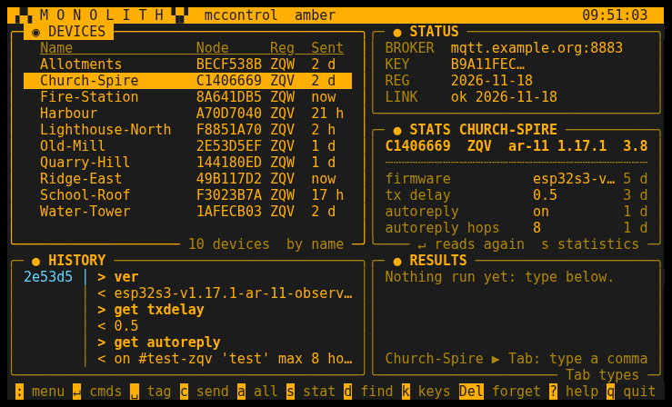
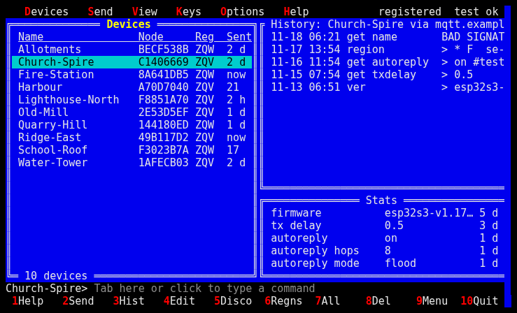
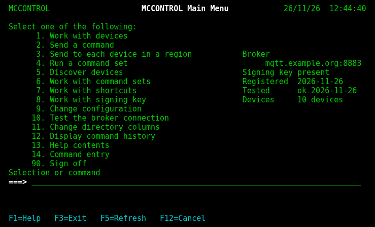
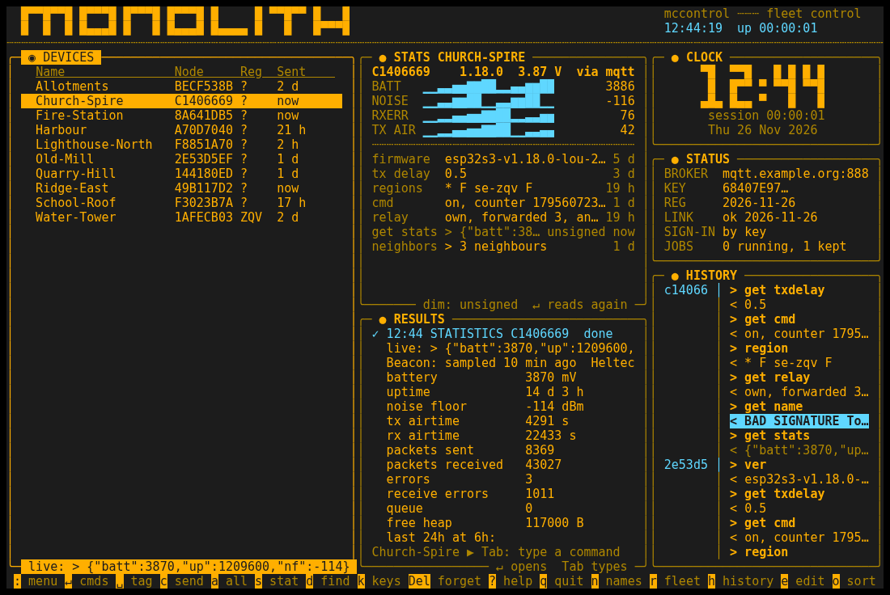
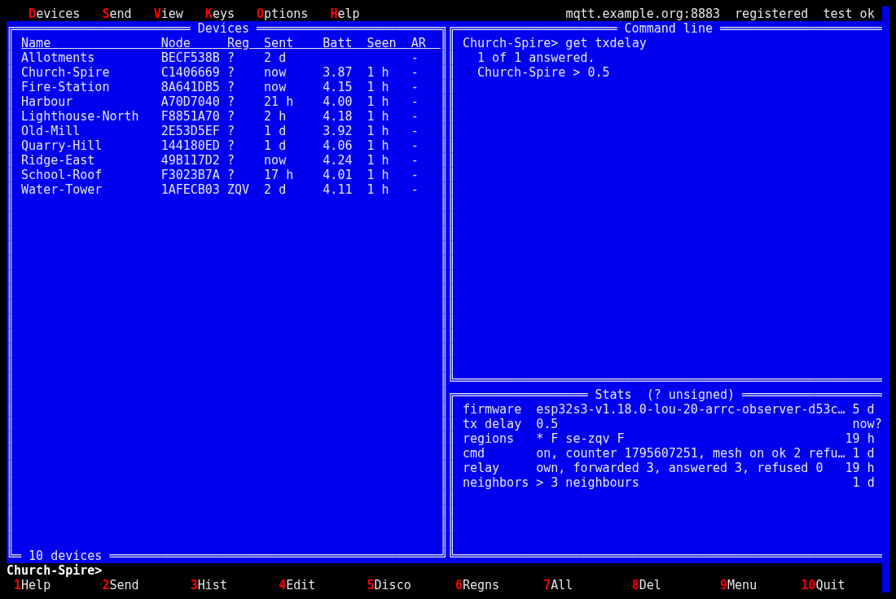
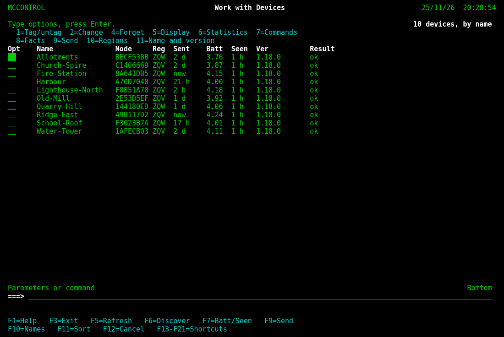

# mccontrol-cli

For the people who run MeshCore Observer repeaters: sign a command with a key kept on your
machine, send it to one repeater, to the ones you tagged, or to each of your repeaters in an
area (one command each), see what came back, and keep a history per device. One backend, three interfaces on it, and a
command line. Python, in a terminal.

What it is not: not a broker, not firmware, and not the browser app. It never changes a
repeater's key, identity or radio (the deny list keeps those to the serial cable), and it sends
nothing unless you ask it to.

mccontrol is four repositories:

- **mccontrol-cli** (this one): the terminal tool, and the reference implementation of the
  protocol. It writes the spec's tables and test vectors from its own code.
- [mccontrol-web](https://github.com/sweden-mesh/mccontrol-web): the same tool in the browser,
  the key kept in the browser; at [mccontrol.meshcoresverige.se](https://mccontrol.meshcoresverige.se).
- [mccontrol-spec](https://github.com/sweden-mesh/mccontrol-spec): the wire format, the command
  table, the deny list and the shared test vectors, as documents and JSON. Both apps pin a tag
  of it; this one keeps its copy in `spec/`.
- [mccontrol](https://github.com/sweden-mesh/mccontrol): a landing page pointing at the three.

The firmware they talk to is [MeshCore-lou](https://github.com/sweden-mesh/MeshCore-lou).

## What changed with lou-20

From firmware lou-20 the control plane is per node and knows no region (the scheme is called
mcc3; mccontrol-spec's wire format has the bytes):

- **Per node, sealed.** A command goes to one node only, on `mcc/cmd/<KEY>` (its whole public
  key), encrypted to that node and signed inside; the answer comes back encrypted to you on a
  reply topic named only inside the command. The broker sees neither the command nor who sent
  it: mccontrol signs in with a throwaway key drawn for each session. There is no IATA, no
  region and no broadcast topic, and every node uses the shared broker.
- **Discovery from alive.** Each lou-20 node keeps a sealed "alive" message on the broker
  (`mcc/alive/<KEY>`, every 15 minutes and at boot) that only its owner's key opens.
  `mccontrol discover` (no region) reads them all and lists the nodes that are yours, wherever
  they are: online, offline (the broker cleared its alive), or no longer yours (rekeyed).
  Nothing is sent. `--add` keeps them; a node found this way needs no region.
- **An area is one command per node.** `send <IATA> ... --all` and `send <county> ... --county`
  (a node's own `region home`, from its alive) send each of your devices there its own
  command, in random order, spaced 10-90 s apart (5-30 min for a restart), so the fleet does
  not restart at one instant. A command that transmits, and the mesh road, go to one node only.
- **The old scheme stays for lou-19 and older.** A node whose alive opened, or whose version
  is lou-20 or later, gets mcc3; any other gets the per-node IATA scheme it has always spoken,
  on its stored region (the device view says which). `mccontrol discover <IATA>` is the old
  discovery, a signed read to that region, which only lou-19 and older still answer. A lou-19
  node takes `ota update` over the old scheme, comes back on lou-20, and moves to mcc3 by itself
  at its first alive. lou-21 removes the old scheme; mccontrol drops it after that.

## The backend and the API

Everything the tool does -- the key, the devices, signing, the broker, Beacon, history --
sits behind a JSON API on `127.0.0.1` (`mccontrol/api/`, standard library only). Each
interface and every subcommand starts it in-process on a free port under a secret path and
talks to it through `mccontrol/apiclient.py`; nothing else of the backend is imported by them,
and `tests/test_isolation.py` fails if it is. The contract is `docs/api/openapi.json`, served
at `<base>/openapi.json`, with a Swagger page over it at `<base>/docs`. `--api <url>` sends a
subcommand to a server already running instead of starting one of its own.

## The interfaces

**[Monolith](mccontrol/ui/Monolith/README.md) is the default**: plain `mccontrol` starts it. A
board of live tiles in phosphor on black -- the directory, STATS (what is known about the cursor
device, each fact with its age), results with a command line under them, a HISTORY of what was
sent and what came back, the broker and key -- with a command palette and the mouse.

The other two do the same work in their own idiom, with the same facts, command line and
history; start one with `mccontrol --ui <name>`:

- [MeshcoreCommander](mccontrol/ui/MeshcoreCommander/README.md): Norton Commander's panels in
  Turbo Pascal colours, every verb on a function key, a DOS-style command line.
- [IBMi](mccontrol/ui/IBMi/README.md): the 5250 green screen -- numbered menus, Opt columns,
  `===>` lines, Command Entry.

Each page has the interface's screens, every key, its menus or palette, and what each pane shows.

| Monolith | MeshcoreCommander | IBMi |
|---|---|---|
| [](mccontrol/ui/Monolith/README.md) | [](mccontrol/ui/MeshcoreCommander/README.md) | [](mccontrol/ui/IBMi/README.md) |

### The three styles, full size

**Monolith**, the default: the directory, STATS with sparklines, the results of a statistics read,
the clock, status and HISTORY.

[](mccontrol/ui/Monolith/README.md)

**MeshcoreCommander**: the directory, a command sent from the command line, Stats.

[](mccontrol/ui/MeshcoreCommander/README.md)

**IBMi**: Work with Devices, with an Opt column and a `===>` line.

[](mccontrol/ui/IBMi/README.md)

Each interface's page has more screens: the command list, a send in progress, history.

The pictures are an invented fleet; `python scripts/screenshots.py` makes them again from the
code as it is (a scratch home, the fake broker and Beacon, each interface in a pseudo-terminal,
headless Chromium for the PNG).

A name given with `--ui` (`ibmi` and `IBMi` are the same) is kept in the configuration, so plain
`mccontrol` starts the last one asked for; with none asked for yet it starts Monolith (and keeps
nothing), and a kept name that is gone since starts Monolith, says so and is forgotten. A name
given that is not there lists them and exits 2. `--api <url>` runs it on a server already
running instead of starting one of its own, and that server's configuration keeps the name:

```
interfaces (mccontrol --ui <name>):
  IBMi               IBMi: the 5250 green screen -- numbered menus, Opt columns, ===> and F3/F5/F12
  MeshcoreCommander  Norton Commander panels in Turbo Pascal colours: the directory, history and every verb on a function key
  Monolith           Monolith: a retro-futuristic board of live tiles, a command palette, phosphor on black
```

Each is a package under `mccontrol/ui/<name>/` with `run(client)`, a one-line `DESCRIPTION` and
its page; a fourth one is a directory more. Without a terminal each says so and exits 2.
`tests/test_parity.py` fails when Monolith gains a verb the other two have no counterpart for.

## Install

```
pip install git+https://github.com/sweden-mesh/mccontrol-cli   # or `pip install .` in a clone
mccontrol keygen                                  # once; prints the two serial commands
mccontrol register                                # once per broker; the broker then checks your commands
mccontrol test                                    # connect, sign in, subscribe, publish, receive
mccontrol discover --add                          # your lou-20 nodes, from their alive messages
mccontrol discover JKG --add                      # lou-19 and older: the nodes in JKG that accept your key
mccontrol                                         # the screens: Monolith, or the last --ui asked for
```

Python 3.10 or newer; `pycryptodome` (Ed25519) and `paho-mqtt`; `curses` from the standard
library; `meshcore` for the mesh road only (`pip install 'mccontrol[mesh]'`). 80x24 is the minimum; wider terminals get wider panels, and on a narrow one each
interface's directory-columns setting (or `mccontrol config --columns ver,result`) picks which
columns the directory shows.

## What it does

- **Keys.** An Ed25519 seed under `~/.config/mccontrol/key.seed`, mode 600, never shown and
  never leaving the machine except inside a signature or a passphrase-encrypted backup
  (`mccontrol key export FILE`, `mccontrol key import FILE`; the web app reads the same file). Each interface's key screen shows
  the two serial commands that provision a repeater, on one line, and refuses to replace a key by accident.
- **Devices.** Name, node id (the first eight hex characters of the public key; the whole key
  is kept too), for lou-19 and older the region (the IATA code its observers use), notes, last
  sent, last result. A lou-20 node needs no region.
- **Discovery.** On lou-20 and later, from the nodes' sealed alive messages: nothing is sent,
  and only your key opens them. On lou-19 and older, one harmless read signed with your key to a
  region's broadcast topic; only a node that verified the signature answers, so every answer is
  a node of yours. A second read fills in names on firmware that admits `get name`.
- **Sending.** One signed command per device to its own topic, never a broadcast: to the
  tagged devices one after another, to an area (an IATA region, or a county with `--county`)
  each of your devices there in random order and spaced; results per device as each interface
  shows them, kept in history; what each device answered is parsed into its facts
  (`GET /devices/{ref}/facts`).
- **Groups.** A named group of devices kept here (`groups.json`), such as `canary` or a site,
  so one action sends the same command to all of them. Each member still gets its own signed
  per-node command on its own topic, through its own region's broker, one after another as a
  send to the tagged does: never a broadcast, no firmware change. Every member's history keeps
  the command and its answer; a member that refuses, stays silent or cannot take the command
  is reported and the rest still go. `mccontrol group create canary loutest gisebo`,
  `group add|remove|show|delete`, `mccontrol groups`, and `mccontrol group send canary ver`,
  which prints a line per device and `canary: 2 of 2 sent; 1 ok, 1 refused, 0 no answer`.
  The API has `/groups` and a `group` target on `/jobs/send` and `/jobs/run-set`.
- **Command sets.** A named list of steps (`region put`, `region allowf`, `region save`, `region`
  is the shipped example) sent in order to the targets, stopping at the first refusal or silence;
  every interface runs and defines them, as does `mccontrol run` and `mccontrol sets`.
- **Statistics.** The node's own counters first, by one signed `get stats` (firmware of
  2026-10-08 or later; older firmware answers not-allowed and the view says so), then what a
  Beacon server holds (read-only HTTP, no credentials): the status block with the sample's age
  and the telemetry history.
- **Help.** Topics with cross-links, a command reference, and the same text on the command line:
  `mccontrol help commands`.

## The command line

```
mccontrol send loutest region put se-jkp '*'
mccontrol send JKG region allowf se-jkp --all # each of your devices in JKG, one command each
mccontrol send se-jkp ver --county       # each of your nodes whose region home is se-jkp
mccontrol send loutest region --dry-run
mccontrol regions loutest
mccontrol alt 2 loutest                  # shortcut 2 (ver); mccontrol shortcuts lists and --set changes them
mccontrol run add-scope loutest se-jkp   # a command set, step by step, stopping at the first refusal; mccontrol sets lists them
mccontrol stats loutest --range 48h      # from Beacon (beacon.meshcore-jkp.se by default; mccontrol config --beacon-url for another)
mccontrol fleet                          # the directory with Batt and Seen refreshed from Beacon
mccontrol refresh [device...]            # get name and ver over the control plane; names the unnamed
mccontrol reads loutest                  # what it last answered to each read, with the age
mccontrol commands [device]              # the command table; with a device, what its firmware lacks is marked
mccontrol history loutest                # a forged reply says BAD SIGNATURE, an unsigned one (unsigned)
mccontrol group send canary ver          # each device of a group in turn; mccontrol groups lists them
mccontrol send loutest ver --via mesh    # over LoRa through your companion; --via auto picks the road
mccontrol send cabin ver --via relay:loutest   # loutest, on MQTT, sends it over LoRa and returns the answer
mccontrol devices | add | remove | discover | key | keygen | config | test | help
```

## Setting up a repeater

Two lines over its serial console, on the firmware of 2026-10-08 or later (ar-11):

```
set mqtt.cmd.pubkey <your 64-hex public key>     # mccontrol key prints it
set mqtt.cmd on                                  # takes a free slot, points it at mqtt-meshcore.louie.se; reboot
```

The node answers `OK - slot 3, mccontrol (mqtts://mqtt-meshcore.louie.se:8883), packets off; reboot to
apply`. A board without PSRAM runs two MQTT slots at once; with both analyzer uplinks up it
says so and asks you to turn one off (`set mqtt2.preset none`) rather than doing it for you.
Then `mccontrol register` once per key, so the broker checks your commands before they fan out.
For a region with its own broker, see the next section.

## Repair a node over the mesh

When a node's Wi-Fi or MQTT fails it drops off the control plane, but its radio is still on the
mesh. From lou-19 a node with the plane (`rc`) also takes your signed commands as a MeshCore
anonymous request (sub-type `0xC1`), sent through your own companion radio with
[meshcore_py](https://pypi.org/project/meshcore/) (`pip install 'mccontrol[mesh]'`). The same key,
signature and counter as on MQTT, so a command delivered both ways runs once; the answer comes
back over the air, encrypted to you by the node. `mccontrol help mesh` is the same text.

**Switch on while it works.** The node's `mqtt.cmd.mesh` is `auto` by default: the road opens
once MQTT has been down 15 minutes (`on` keeps it open, `off` shuts it; set on the console only).
Check it now with `mccontrol group send <group> get mqtt.cmd.mesh`. Each device needs its whole
public key (discovery stores it; `PATCH /devices/{ref}` with `key` otherwise). Set your companion
once: `mccontrol config --companion tcp:HOST:PORT` (a Wi-Fi companion, see below; or
`serial:/dev/ttyACM0`, `ble:ADDRESS`).

**The recipe.**

```
mccontrol send loutest set wifi.ssid HomeNet --via mesh      # or set wifi.pwd, or:
mccontrol send loutest set mqtt.cmd on mqtt-meshcore.louie.se --via mesh
mccontrol send loutest reboot --via mesh                     # answers nothing: it restarts first
mccontrol send loutest ver                                   # a few minutes later: back on MQTT?
```

A lou-20 node takes the sealed request (sub-type `0xC2`, a command of at most 57 bytes); one on
lou-19 the `0xC1` above (59 bytes); mccontrol picks per node as it does on MQTT.

Over the mesh the plane admits what it admits over MQTT and, only there, the repair
(operator ruling 2026-11-16): `set wifi.ssid <v>`, `set wifi.pwd <v>`, `set mqtt.cmd on [<host>]`.
Everything else denied stays denied; the command key stays serial-only. A command is at most
59 bytes, checked before signing; one node at a time, never a region; the node answers at most
one a minute and ten an hour this way. `mesh-closed` means its MQTT works: send it there. Silence
is not a refusal. A node not yet a contact on the companion is made one, and its first request
floods once; the answer teaches the companion a path, and the next goes direct.

`--via auto` takes the mesh for a mesh-only node, a command only the mesh admits, a node whose
status Beacon (else its last MQTT answer) has not seen for `mesh_after_mins` (15), or a broker
that cannot be reached; otherwise MQTT, and MQTT again after a `mesh-closed`. History records
the road of every command (`mqtt`, `mesh` or `relay`).

### Through a relay (lou-20)

A node of yours on MQTT can send the mesh request for you, so no companion is needed:
`mccontrol send cabin ver --via relay:loutest`. The relay sends it direct with no hops, which is
right when the node hears the relay itself. Further away, give the hops (`--path A1B2`, or
`2:A1B2C3D4` for two-byte hashes) or flood once: `--route flood` stays in the relay's region home,
`--route flood-wide` uses its default scope. An answer teaches the path; the next direct send
through that relay uses it (`--path none` for no hops again).

One node at a time, never an area or a group, and only what the mesh road admits (57 bytes to
lou-20, 59 to lou-19). You name the relay: `--via auto` never picks one. The relay must run lou-20
or later and be on MQTT. It sends one command at a time within an airtime budget (about 26 in 15
minutes, then 5 in the next 15; a flood at most once a minute) and waits two minutes for the answer. `no answer` is not a refusal: the node may have run the command. Any
other word from the relay (`rate-limited`, `busy`, `off`, ...) means nothing was sent. Relaying is
on by default: `set mqtt.relay off|own`, and `get mqtt.relay` shows what is left of the budget.
History keeps the relay, the route and how well the relay heard the answer.

A **mesh-only** node (an `rc` image built without Wi-Fi: no `-observer` in its version, or a
device's `mesh_only` flag) takes commands over the mesh alone, signed for
`meshcore/mesh/{KEY}/cmd`, and refuses the repair, `ota check`, `ota update`, `mqtt.cmd ping` and
the broker slots' settings (`set mqttN.*`). On an Observer node the mesh road already reaches
those slot settings, so a broken Observer feed can be repaired over the mesh.
The bytes are in mccontrol-spec's [wire format](https://github.com/sweden-mesh/mccontrol-spec/blob/main/docs/wire-format.md)
and pinned, with the firmware's own worked vectors, in `spec/vectors/vectors.json` (`mesh`).

### A companion over the network (`tcp:HOST:PORT`)

A companion running the **Wi-Fi companion firmware** (`companion_radio_wifi`) listens on TCP port
5000: `mccontrol config --companion tcp:192.168.1.30:5000`. It serves **one client**: each mesh
command connects and drops whatever held the port (the phone app, Home Assistant). To share it,
put a mux in front (e.g. meshcore-tcp-mux) and give the CLI the mux's shared port instead
(`tcp:HOST:5001`). The web app reaches the same companion through
[mccontrol-bridge](https://github.com/sweden-mesh/mccontrol-bridge).

## Your own region

This section is for nodes on lou-19 and older. From lou-20 every node uses the shared broker,
with no region and no IATA in its topics; a region's own broker serves only the old scheme.

Every region can use the shared broker, `mqtt-meshcore.louie.se`. It serves every IATA, keeps
each region's counts and broadcast caps apart, and is the default: a region needs nothing
configured to use it. A region may also run its own broker (mcbroker's `DEPLOY.md` is the
guide), and can move between the two at any time without losing a device: a device belongs to
a region, and a region points at a broker.

**Who does what.** The *region operator* runs the region's broker (or decides to use the shared
one), keeps its host, certificate, reader accounts and the revoked and approved key files, and
tells the region the broker's host name. A *repeater owner* makes a key, registers it with that
broker, provisions their own repeaters and adds them here. An owner commands only the repeaters
that hold their public key; the broker stops forgeries and floods, it does not hand out access.

1. **A key**, once: `mccontrol keygen` (`mccontrol key` prints the public half).
2. **The region's broker**, only if it is not the shared one:

   ```
   mccontrol config --region-broker VGR=mqtt.meshcore-vgr.se   # VGR= moves it back to the shared broker
   ```

   A region with no entry uses `broker`, the shared broker. Port, TLS and a password login are
   the same for every broker; the login token is signed for each broker's own name.
3. **Register** once per broker: `mccontrol register` registers with every broker in use
   (`--region VGR` for that one only); `mccontrol key` says where the key is registered, and
   `mccontrol test --region VGR` connects, signs in, publishes and receives there.
4. **Provision each repeater** over serial: `set mqtt.cmd.pubkey <your 64-hex public key>`, then
   the command slot. For the shared broker that is `set mqtt.cmd on`. For a region's own broker,
   `set mqtt.cmd on mqtt.meshcore-vgr.se` (firmware lou-18 and later); on lou-17 and older a custom
   slot (any free one from 2 to 6):

   ```
   set mqtt3.preset custom
   set mqtt3.server mqtts://mqtt.meshcore-vgr.se:8883
   set mqtt3.audience mqtt.meshcore-vgr.se
   set mqtt3.filter all
   set mqtt.cmd.slot 3
   set mqtt.cmd on
   reboot
   ```

   `set mqtt.iata VGR` sets the region the node's topics carry; it must be the device's region
   here. The regional website's wizards print these lines from one setting.
5. **Add the devices**: `mccontrol discover VGR --add`, or `mccontrol add <name> <node> VGR`.

Each device shows the broker it is reached through: `mccontrol devices`, the API's `broker`
field, and each interface's device view. Discovery and broadcasts go to the region's broker and
listen only to that region's topics, so several regions can share one broker. `mccontrol help
ownregion` has the same steps.

## Signing in

With no username configured, the tool signs in to the broker the way a node does: the
username is `v1_` plus its public key, the password a token signed by its key
(`mccontrol/token.py`, the firmware's own JWT shape byte for byte), renewed each session.
Nothing is handed out or typed; the key is the identity, and that is how the default broker
`mqtt-meshcore.louie.se` knows who publishes. A login from the broker's password file sets its username
and password, and those are used instead.

The lou-20 plane (mcc3) signs in differently: with a throwaway key drawn for each session, so
the broker never learns which key owns which commands; your key only signs and seals.

## The configuration is the control brokers

The only thing configured is the control brokers: `broker`, the shared broker (default
`mqtt-meshcore.louie.se`, the broker a node's `mqtt.cmd.slot` points at), `brokers`, each region's
own broker by IATA (empty by default), and the port, username, password and how long to wait
for answers, the same for every broker.
The full feature set needs the broker to run the mcbroker Mosquitto plugin. A region belongs to
a device, not to the configuration. A configuration that still names a former name of the default
broker (`mqtt.meshcore-jkp.se`, `mqtt.louie.se`) is moved to the current one when it is read, so
the next login signs its token for the name the broker accepts.

```
~/.config/mccontrol/
    key.seed            your private seed, mode 600
    config.json         the control brokers, where the key is registered, how long to wait,
                        your companion for the mesh road
    devices.json        your devices (a region only for lou-19 and older)
    ecdh/               the shared secret per node for mcc3, cached (0600)
    groups.json         your device groups: name -> the devices in it
    history/<node>.jsonl
```

`MCCONTROL_HOME` keeps them elsewhere.

## The protocol

For lou-20 and later, mcc3: a command is sealed to one node (X25519 from the node's key and yours,
ChaCha20-Poly1305, signed inside by your key over the node's key, a counter, the expiry and
the reply id), published on `mcc/cmd/<KEY>`; the result is sealed to you on `mcc/r/<RID>`, a reply
id drawn per session; the alive message is `mcc/alive/<KEY>`, retained. A forward through a relay
is sealed to the relay on its `mcc/cmd/<KEY>` and carries the mesh request, signed and sealed for
the target; the relay's result comes back on the same reply id. The bytes and their
vectors are in mccontrol-spec (`spec/vectors/mcc3-vectors.json`). What follows is the old
scheme, for lou-19 and older.

The envelope is the one the Observer auto-reply firmware verifies (`src/helpers/MqttControlLogic.h`
there): the node's topic is named by its whole 64-hex key from firmware ar-11 and by the first
8 hex before that -- the tool keeps the key per device and addresses each by the form its
firmware uses, showing the 8-hex id as the name; `v1|counter|expiry|command|signature`, signed over the topic and the body together, so a
command captured from one node cannot be replayed at another. The node checks the signature,
that the counter is higher than the last it accepted, the expiry, its rate limit, and a deny
list of commands (since 2026-10-08 everything the console answers travels except identity, the
control plane's own settings, credentials, the destructive group, position and role, the radio,
transmissions and the clock step; `mccontrol help commands` has it, and `mccontrol/denylist.py`
mirrors it so a refusal is explained before signing); a result is published only when the
signature verified. A region tree
line (`region def a|* b|*`) cannot travel: `|` is the field separator; `region put` one name at
a time does the same job. `mccontrol help protocol` has the rest.

What that buys, and what it does not: no one on the broker can alter a field, move a command
to another node or region, turn it into a broadcast, or replay it at a node that has seen it;
a captured envelope can run once at most, and only within its life. The broker can still
drop or delay a command and read everything. A result from firmware ar-11 or later is signed by
the node and shown `[signed]`; a forged one shows as BAD SIGNATURE and is ignored; an unsigned
`r1` from older firmware is shown as is -- confirm those with a read rather than with the `ok`. Each property is a test
in `tests/test_envelope.py`; `mccontrol help assurance` is the argument in full.

## Tests

`pytest` runs the unit tests, the API against its OpenAPI document, the isolation test, and
pseudo-terminal walks of each interface against a scripted transport (`MCCONTROL_FAKE_RESULTS`):
every function key, option and verb pressed once, on an 80x24 and a wider terminal.
`tests/test_parity.py` holds MeshcoreCommander and IBMi to Monolith's verbs, and
`tests/test_pages.py` the pages' links and keys to the code.

`python scripts/screenshots.py` remakes `docs/screenshots/` from an invented fleet (it needs
headless Chromium; `--only <name>` for one picture, `--keep-html` to keep the pages it renders).

## The spec

The behaviour the web app shares with this package -- commands, deny list, cautions, result
codes, facts, help, firmware checks, brokers, areas, the protocol's constants -- and the shared
test vectors live in [mccontrol-spec](https://github.com/sweden-mesh/mccontrol-spec).
`spec/` is a copy of one of its tags, made by `python scripts/spec_sync.py <tag>` (or
`--from ../mccontrol-spec`), and checked offline by `tests/test_spec.py`;
`python scripts/spec_sync.py --check` compares it with GitHub.

`python -m mccontrol.webexport --out ../mccontrol-spec` writes those files from this package's
code, and `tests/test_webexport.py` fails when that differs from `spec/`. A change that alters
them is released as a new spec tag, then synced here and in mccontrol-web.
